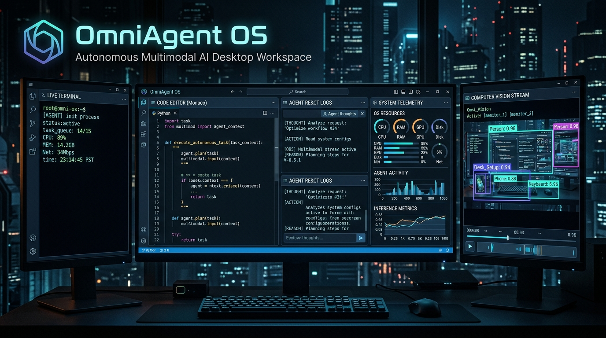
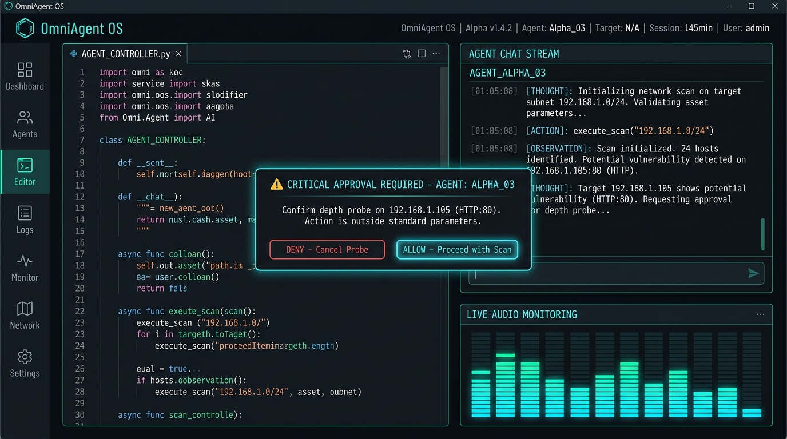
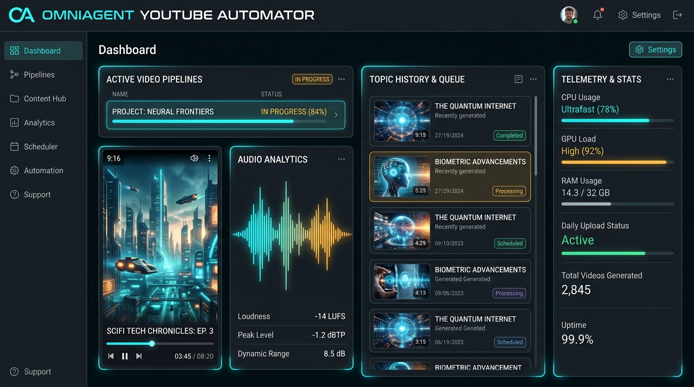
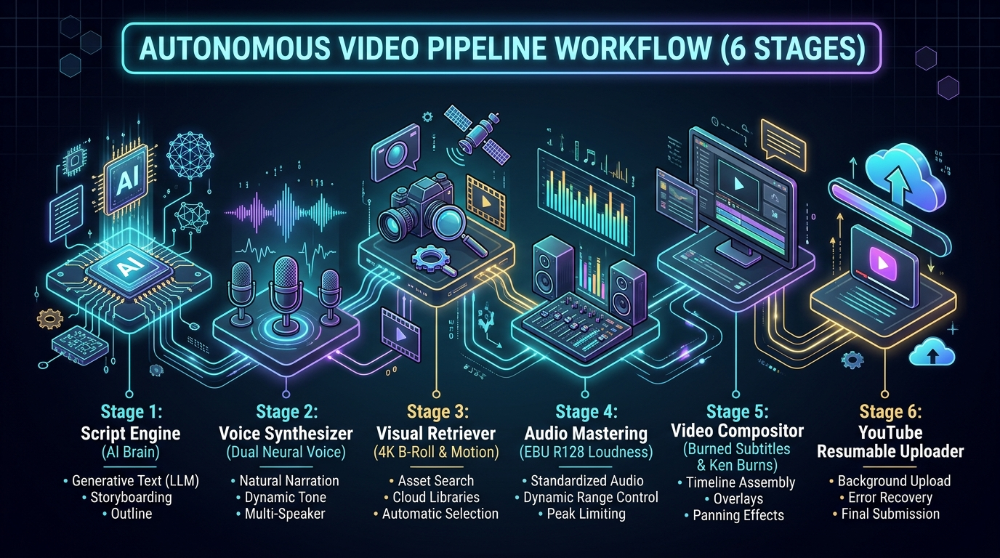
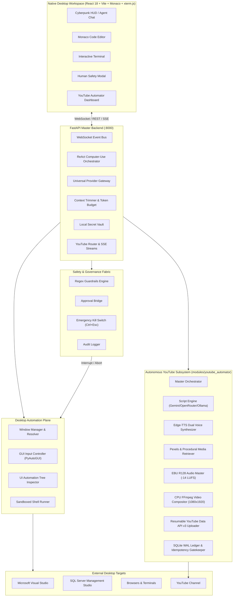

<div align="center">

# 🌐 OmniAgent OS
### Sovereign Multimodal Autonomous Desktop Agent & YouTube Video Factory

[](LICENSE)
[](https://python.org)
[](https://fastapi.tiangolo.com)
[](https://react.dev)
[](https://vitejs.dev)
[](https://ffmpeg.org)
[](#-subsystem-autonomous-youtube-video-factory)
[](#-database--state-ledger-architecture)
[](https://microsoft.com/windows)

<p align="center">
  
</p>

<p align="center">
  <b>OmniAgent OS</b> is a sovereign, full-stack, multimodal operating system controller that bridges autonomous LLM reasoning with native computer use. Operating as a <b>100% native standalone desktop application</b> (zero browser chrome or URLs), it executes computer vision, keyboard/mouse actions, and deep process control across <b>Visual Studio, SQL Server Management Studio (SSMS), Terminal Consoles, and Web Browsers</b> with an integrated <b>Human-in-the-Loop Safety Gate</b> and an autonomous <b>Zero-VRAM, 100% Free YouTube Shorts & Video Podcast Pipeline</b>.
</p>

---

[Key Capabilities](#-key-capabilities) •
[UI Showcase](#-ui-showcase) •
[System Architecture](#-system-architecture) •
[YouTube Automator Subsystem](#-subsystem-autonomous-youtube-video-factory) •
[Master Tool Registry](#-master-tool-registry) •
[Quickstart](#-quickstart) •
[Safety Fabric](#-human-in-the-loop-safety-fabric) •
[Uninstall & Cleanup](#-uninstaller--clean-removal)

---

</div>

## 📸 UI Showcase

<div align="center">

### 🖥️ 1. Cyberpunk Desktop HUD & Autonomous OS Controller

<p><i>OmniAgent OS Cyberpunk HUD: Integrated Monaco Editor, Autonomous ReAct Reasoning Stream, Interactive Safety Gate Modal, and Live Audio Frequency Visualizer.</i></p>

<br>

### 🎬 2. Autonomous YouTube Video Factory Dashboard

<p><i>YouTube Automator Subsystem: Channel Telemetry, Active Pipeline Status, 9:16 Video Player, Rolling Topic History, EBU R128 Audio Analytics, and Idempotency Ledger.</i></p>

<br>

### ⚡ 3. 6-Stage Autonomous Pipeline Workflow

<p><i>Headless Pipeline: Multi-Modal Scripting → Dual Neural Voice Synthesis → Vertical 4K B-Roll → EBU R128 Audio Mastering → CPU Video Composition → Resumable YouTube Upload.</i></p>

</div>

---

## 🚀 Key Capabilities

### 💻 1. Sovereign Native Desktop Application
* **Zero Browser Chrome:** Runs as a dedicated hardware-accelerated standalone desktop window powered by Microsoft Edge / Chromium App Runtime.
* **1-Click Launch:** Pre-configured with a 1-click desktop shortcut (`OmniAgent OS.lnk`) and self-bootstrapping launcher (`run_setup.bat`).
* **Zero System Pollution:** Bootstraps portable CPython and maintains all dependencies, models, and caches strictly within the local project folder.

### 🧠 2. Universal Multi-Provider Gateway
* **Supported Engines:** Seamless streaming integration with **OpenRouter**, **Google Gemini** (Gemini 2.5 / Flash), **Anthropic Claude** (Claude Sonnet 3.7 / 3.5), **OpenAI** (GPT-4o), **xAI Grok**, and local offline **Ollama / vLLM / LM Studio**.
* **Reasoning Thought Signatures:** Full preservation of Google Gemini `thought_signature` encrypted tokens during multi-turn function calling.
* **Intelligent Failover:** Automatic fallback routing across providers with credit exhaustion (HTTP 402/429) protection.
* **Token Budget Optimizer:** Intelligently caches visual context and compacts conversation history within token limits.

### 🎮 3. Desktop Automation & GUI Controller
* **Cross-Desktop WinSta0\default Enumeration:** Discovers and controls all active windows across Windows desktop sessions.
* **Normalized 0–1000 Coordinate Mapper:** DPI-aware resolution translation mapping normalized coordinates to physical pixels across multi-monitor setups.
* **Native Hotkey & Unicode Synthesizer:** Smooth mouse clicks, mouse dragging, hotkey chords (`F5`, `Ctrl+N`, `Ctrl+Shift+B`, `Ctrl+E`), and safe Unicode clipboard typing.
* **Specialized Software Recipes:**
  * **Visual Studio:** Solution opening, build triggers, debugging sessions, error window parsing.
  * **SQL Server Management Studio (SSMS):** Automatic window focusing (`SwitchToThisWindow`), new query tab creation (`Ctrl+N`), script injection, and query execution (`F5`).

### 👁️ 4. Sensory Multimodal Subsystem
* **Real-time Screen Capture:** High-performance screen grabs via `mss` with visual difference tracking and coordinate grid overlays.
* **Offline Speech-to-Text (STT):** Local voice transcription powered by `faster-whisper`.
* **Offline Text-to-Speech (TTS):** Non-blocking voice audio synthesizer using `pyttsx3`.
* **Voice Activity Detection (VAD):** Adaptive microphone listener for conversational interaction.

### 🛡️ 5. Human-in-the-Loop Safety Gate & Kill Switch
* **Destructive Command Interception:** Real-time regex pattern matcher blocking destructive shell commands (`rm -rf`, `del /s /q`, `format`, `diskpart`) and destructive SQL queries (`DROP DATABASE`, `DROP TABLE`, `TRUNCATE`, unconditional `DELETE`).
* **Interactive Approval Cards:** Emits instant WebSocket approval prompts to the UI requiring explicit user **`ALLOW`** or **`DENY`**.
* **Global Hardware Kill Switch:** Arms a global **`Ctrl + Esc`** hotkey listener and UI emergency stop button that immediately freezes all mouse/keyboard automation and aborts running subprocesses.
* **Append-Only Audit Journal:** Size-rotated JSON-lines audit journal (`workspace_audit.log`) recording every tool invocation and safety decision.

---

## 🎬 Subsystem: Autonomous YouTube Video Factory

OmniAgent OS features a built-in, completely autonomous video creation and publishing factory located in [`modules/youtube_automator`](modules/youtube_automator/README.md).

### 💎 Zero-Cost, Pure-CPU Hardware Profile
* **0 MB GPU VRAM:** Runs on pure CPU with `-c:v libx264 -preset ultrafast -threads 4` (no NVENC/CUDA requirements; runs on integrated graphics or low-power servers).
* **$0.00 Cloud Rendering Expense:** 100% locally rendered using FFmpeg 9.0+.
* **$0.00 Neural Voice Expense:** Free dual-voice narration powered by Microsoft Edge TTS (`en-US-ChristopherNeural` and `en-US-EmmaNeural`).
* **$0.00 Stock Footage Expense:** Free 4K vertical B-roll queries via Pexels API with stylish procedural FFmpeg fallbacks.

### ⚙️ The 6-Stage Production Pipeline
1. **Script Engine (`core/script_engine.py`):** Multi-modal LLM router (Gemini / OpenRouter / Ollama) generating high-retention 3-act viral hooks or 2-speaker podcast debates.
2. **Voice Synthesizer (`core/voice_synthesizer.py`):** Edge-TTS speech generation with sentence boundary capture and word-interpolated exact `.srt` captions.
3. **Media Retriever (`core/media_retriever.py`):** Queries Pexels for vertical HD/4K videos (`orientation=portrait`), falling back gracefully to procedural chromatic animations.
4. **Audio Master Engine (`core/audio_master.py`):** Two-pass **EBU R128 loudness normalization** (-14.0 LUFS integrated loudness, -1.5 dBTP true peak) with automatic background music ducking (-14 dB).
5. **Video Compositor (`core/video_compositor.py`):** Ken Burns image motion engine (`zoompan`), B-roll standardizer (1080x1920 9:16 vertical), and bold yellow/black safe-zone burned captions (`MarginV=260`).
6. **Resumable YouTube Uploader (`core/uploader.py`):** Resumable chunked upload over YouTube Data API v3 with exponential retry backoff and simulated dry-run validation.

### 🛡️ Daily Idempotency & SQLite WAL Ledger
* **Idempotency Gatekeeper:** Queries the SQLite WAL ledger for today's local date (`YYYY-MM-DD`). If a `COMPLETED` upload exists, the orchestrator terminates in **`< 100ms`**, preventing duplicate uploads if Windows reboots multiple times.
* **Anti-Repetition Topic Memory:** Maintains a rolling 30-day topic history buffer injected into LLM prompts as negative constraints.
* **Ephemeral Cache Purge:** Cleans up intermediate clips and audio upon successful publishing.

---

## 🏗️ System Architecture



---

## ⚡ Quickstart

### Option 1: 1-Click Launch (Windows)
Double-click:
```cmd
run_setup.bat
```
*(Or double-click the **OmniAgent OS** shortcut on your Windows desktop).*

The launcher automatically:
1. Validates or bootstraps an isolated Python runtime into `.venv/`.
2. Installs backend dependencies (`fastapi`, `uvicorn`, `pywin32`, `edge-tts`, `google-api-python-client`, etc.).
3. Builds frontend packages into `frontend/dist/`.
4. Launches OmniAgent OS in sovereign desktop window mode.

---

### Option 2: 1-Click YouTube Pipeline Run
To generate a video right now or test in dry-run mode:

```bash
# Test complete pipeline without publishing to YouTube
python modules/youtube_automator/orchestrator.py --dry-run --force

# Live generation and upload
python modules/youtube_automator/orchestrator.py
```

Or double-click:
```cmd
scripts\start_youtube.bat
```

For silent headless background scheduling (Windows Task Scheduler):
```cmd
wscript scripts\run_youtube_silent.vbs
```

---

### Option 3: Manual Developer Setup

#### 1. Clone the repository
```bash
git clone https://github.com/basitaliyousafzai/OmniAgent.git
cd OmniAgent
```

#### 2. Setup Python Virtual Environment
```bash
python -m venv .venv
.\.venv\Scripts\activate
pip install -r backend/requirements.txt -r modules/youtube_automator/requirements.txt
```

#### 3. Build Frontend Assets
```bash
cd frontend
npm install
npm run build
cd ..
```

#### 4. Configure Secrets
Copy `.env.example` to `.env.local` and add your API keys:
```bash
cp .env.example .env.local
```
Edit `.env.local`:
```env
GEMINI_API_KEY="your-google-gemini-key"
OPENROUTER_API_KEY="your-openrouter-key"
PEXELS_API_KEY="your-pexels-api-key"
```

#### 5. Launch the Desktop Application
```bash
.\.venv\Scripts\python.exe desktop_app.py
```

---

## 🧰 Master Tool Registry

OmniAgent OS equips autonomous reasoning models with 12+ specialized OS control tools:

| Tool Name | Scope | Description |
| :--- | :--- | :--- |
| `launch_or_focus_app` | Window Management | Finds, launches, or brings an application window to foreground using Windows `SwitchToThisWindow`. |
| `app_action` | Application Recipes | Executes specialized recipes for Visual Studio (`build`, `debug`, `error_list`) and SSMS (`new_query`, `execute_query`). |
| `gui_mouse_action` | Input Control | Performs left, right, or double clicks, moves, and drags using normalized 0–1000 coordinates. |
| `type_string` | Keyboard Control | Types text with clipboard fallback (`pyperclip`) for fast, Unicode-safe input. |
| `send_hotkey` | Keyboard Chords | Sends system and IDE shortcut combinations (e.g. `['ctrl', 'n']`, `['f5']`, `['ctrl', 'shift', 'b']`). |
| `capture_desktop_view` | Vision | Grabs full-color screenshots of primary or secondary displays with optional 0–1000 coordinate grids. |
| `list_open_windows` | Window Discovery | Enumerates all visible top-level windows across `WinSta0\default` with titles, HWNDs, and PIDs. |
| `read_file` | File System | Reads contents of files confined to the permitted workspace root. |
| `write_file` | File System | Creates or overwrites files with automatic backup logging. |
| `apply_patch` | Code Editing | Performs precise target/replacement block patching on source files. |
| `execute_shell` | Shell Runner | Runs commands in sandboxed PowerShell/Bash sessions with process tree timeout management. |
| `inspect_ui_tree` | Accessibility | Dumps the Windows UI Automation control hierarchy for targeted element identification. |

---

## 🛑 Human-in-the-Loop Safety Fabric

OmniAgent OS enforces strict guardrails to prevent accidental system destruction:

### 1. Intercepted Patterns
* **Shell Destruction:** `rmdir /s /q`, `del /s /q`, `format`, `diskpart`, `rm -rf /`, `mkfs`, `dd if=`.
* **SQL Destruction:** `DROP DATABASE`, `DROP TABLE`, `TRUNCATE TABLE`, `ALTER TABLE ... DROP`, `DELETE FROM ...` without a `WHERE` clause.
* **System Sabotage:** Windows Registry deletion (`reg delete`), system shutdown (`shutdown /s /f`).

### 2. Emergency Controls
* **Hardware Hotkey Kill Switch:** Press **`Ctrl + Esc`** at any moment to immediately terminate the agent loop and freeze mouse/keyboard control.
* **UI Emergency Button:** One-click emergency kill button located in the sidebar header and status bar.

---

## 🧹 Uninstaller & Clean Removal

To stop running background services:
```cmd
STOP_OMNIAGENT.bat
```

To permanently remove all runtime environments, model caches, logs, secrets, and temp profiles:
```cmd
UNINSTALL_AND_CLEANUP.bat
```
*(Refer to [`UNINSTALL_GUIDE.md`](UNINSTALL_GUIDE.md) for full manifest details).*

---

## 📄 License

Distributed under the MIT License. See [LICENSE](LICENSE) for more information.

---

<div align="center">
  <sub>Engineered with precision for autonomous computing and automated media production.<br>Built by <a href="https://github.com/basitaliyousafzai">Basit Ali Yousafzai</a>.</sub>
</div>
