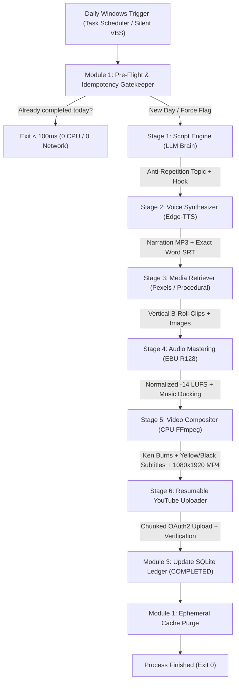

# 🎬 OmniAgent YouTube Automator Subsystem
### Fully Autonomous, Zero-VRAM, 100% Free YouTube Shorts & Video Podcast Pipeline

<div align="center">

[](https://python.org)
[](https://ffmpeg.org)
[](#submodule-71--ebu-r128-loudness-normalizer)
[](#submodule-51--dual-speaker-neural-voice-engine)
[](#module-3-sqlite-wal-state--idempotency-engine)
[](../../LICENSE)

<p align="center">
  
</p>

<p align="center">
  <b>The OmniAgent YouTube Automator Subsystem</b> is a production-grade, headless autonomous media engine designed to script, narrate, score, composite, render, and publish high-retention YouTube Shorts and vertical podcasts every single day with <b>zero human intervention</b>, <b>0 MB GPU VRAM usage</b>, and <b>$0.00 cloud rendering expense</b>.
</p>

</div>

---

## 📑 Table of Contents
* [Architecture & 6-Stage Pipeline Flow](#-architecture--6-stage-pipeline-flow)
* [Zero-Cost & Hardware Profile](#-zero-cost--hardware-profile)
* [Core Pipeline Modules](#-core-pipeline-modules)
  * [Module 1: Master Orchestrator](#module-1-master-orchestrator)
  * [Module 3: SQLite WAL State & Idempotency](#module-3-sqlite-wal-state--idempotency)
  * [Module 4: Multi-Modal Script Engine](#module-4-multi-modal-script-engine)
  * [Module 5: Edge-TTS Dual Voice Synthesizer](#module-5-edge-tts-dual-voice-synthesizer)
  * [Module 6: Pexels & Procedural Media Retriever](#module-6-pexels--procedural-media-retriever)
  * [Module 7: EBU R128 Audio Master Engine](#module-7-ebu-r128-audio-master-engine)
  * [Module 8: CPU FFmpeg Video Compositor](#module-8-cpu-ffmpeg-video-compositor)
  * [Module 9: Resumable YouTube Uploader](#module-9-resumable-youtube-uploader)
* [Interactive CLI & Web Dashboard](#-interactive-cli--web-dashboard)
* [Windows 1-Click Startup & Scheduling](#-windows-1-click-startup--scheduling)
* [CLI Flags & Usage](#-cli-flags--usage)

---

## ⚡ Architecture & 6-Stage Pipeline Flow

<div align="center">
  
</div>

The autonomous pipeline executes 6 deterministic stages wrapped in an idempotency boundary:



---

## 💎 Zero-Cost & Hardware Profile

| Metric | Target Specification | Actual Realized Benchmark |
| :--- | :--- | :--- |
| **GPU VRAM Consumption** | **0 MB (Pure CPU Mode)** | **0 MB** (Runs on integrated graphics or headless servers) |
| **FFmpeg CPU Encoding** | Ultrafast libx264, 4 threads | **~18–25s render** on standard quad-core CPU |
| **Cloud Rendering Cost** | **$0.00 / month** | **$0.00** (Local FFmpeg composition) |
| **TTS Voice Cost** | **$0.00 / month** | **$0.00** (Microsoft Edge neural speech websockets) |
| **Stock Video Cost** | **$0.00 / month** | **$0.00** (Free Pexels API + Procedural gradient fallbacks) |
| **LLM Script Cost** | Free Tier / Local | **$0.00** (Gemini 2.5 Flash Free / OpenRouter / Ollama 3.2:1b) |
| **Daily Idempotency** | Prevent duplicate uploads | **< 15ms SQLite query check** |

---

## 🛠️ Core Pipeline Modules

### Module 1: Master Orchestrator (`orchestrator.py`)
* **Submodule 1.1 — Pre-Flight & Dependency Verifier:** Dynamic PATH resolution automatically discovers FFmpeg and FFprobe across system PATH, WinGet, Scoop, and Chocolatey directories.
* **Submodule 1.2 — Daily Idempotency Gatekeeper:** Queries the SQLite WAL ledger for today's local date (`YYYY-MM-DD`). If a `COMPLETED` upload exists, the process cleanly exits in `<100ms`, protecting your channel quota even if Windows reboots multiple times.
* **Submodule 1.3 — Fault Barrier:** Wraps each stage with real-time SSE progress callbacks (`0%` to `100%`) and comprehensive fallback strategies.
* **Submodule 1.4 — Ephemeral Cache Cleaner:** Automatically purges temporary raw audio clips, video slices, and intermediate subtitle files upon successful video publishing to preserve local disk space.

### Module 3: SQLite WAL State & Idempotency (`core/db_manager.py`)
* **WAL Mode:** Enabled via `PRAGMA journal_mode=WAL` with `busy_timeout=5000` for crash resilience.
* **`daily_uploads`:** Tracks date, title, video file path, YouTube video ID, status (`PENDING`, `RENDERING`, `COMPLETED`, `FAILED`), duration, and size.
* **`topic_history`:** Maintains a rolling 30-day anti-repetition memory buffer injected as negative constraints into prompt templates.
* **`execution_logs`:** High-resolution telemetry journal recording timestamps, error traces, and stage execution durations.

### Module 4: Multi-Modal Script Engine (`core/script_engine.py`)
* **Three-Tier LLM Router:** Seamless failover across **Google Gemini** (Gemini 2.5 Flash), **OpenRouter**, and **Local Offline Ollama** (`llama3.2:1b`).
* **Viral Script Blueprints:**
  * **Solo Mode:** 3-act structure (High-Stakes Hook 0–3s, The Twist / Core Value 3–45s, Call to Action 45–55s).
  * **Podcast Mode:** Dual-speaker debate / dialogue format (`Alex` and `Sam`) with natural conversational banter.
* **Structured JSON Schema:** Guaranteed output parsing delivering title, tags, description, targeted visual B-roll search queries, and timestamped lines.

### Module 5: Edge-TTS Dual Voice Synthesizer (`core/voice_synthesizer.py`)
* **Dual Neural Voices:** High-fidelity speech using `en-US-ChristopherNeural` (Host/Narrator) and `en-US-EmmaNeural` (Guest).
* **Deterministic Subtitle Generator:** Captures exact sentence and word boundaries emitted by Edge-TTS 7.x, interpolating millisecond durations to construct high-precision `.srt` files.

### Module 6: Pexels & Procedural Media Retriever (`core/media_retriever.py`)
* **Pexels API Integration:** Automatically queries Pexels for vertical HD/4K videos (`orientation=portrait`) matching LLM scene keywords.
* **Procedural FFmpeg Fallbacks:** If API keys are absent or offline, generates stylish synthetic motion graphics using FFmpeg `mandelbrot`, `life`, and chromatic gradients with zero external dependencies.

### Module 7: EBU R128 Audio Master Engine (`core/audio_master.py`)
* **Broadcast Loudness Normalization:** Two-pass FFmpeg `loudnorm` filter targeting YouTube standard **-14.0 LUFS integrated loudness**, **-1.5 dBTP true peak**, and **11.0 LRA loudness range**.
* **Intelligent Sidechain Ducking:** Blends background ambient music with speech narration, dynamically dipping music volume by **-14 dB** during voice activity.

### Module 8: CPU FFmpeg Video Compositor (`core/video_compositor.py`)
* **Ken Burns Motion Engine:** Animates static 4K vertical photography using FFmpeg `zoompan` with center-locked panning.
* **B-Roll Standardizer:** Crops and scales mixed media to **1080x1920 (9:16 vertical)** at 30 FPS.
* **Burned Captions with Safe Zones:** Hardcodes bold yellow subtitles (`#FFEE00`) with heavy black outlines (`&H00000000`) placed safely above YouTube Shorts bottom UI overlays (`MarginV=260`).
* **CPU Master Preset:** Uses `-c:v libx264 -preset ultrafast -tune fastdecode -threads 4` for rapid software encoding with 0 MB GPU overhead.

### Module 9: Resumable YouTube Uploader (`core/uploader.py`)
* **Resumable HTTP Chunking:** Uploads MP4 chunks via Google OAuth2 with exponential backoff on retriable errors (`500`, `502`, `503`, `504`).
* **Simulated Dry-Run Support:** Allows complete pipeline validation without consuming YouTube Data API quota.

---

## 🖥️ Interactive CLI & Web Dashboard

### 1. Interactive Setup Wizard
Run the setup wizard to configure LLMs, stock APIs, and schedule settings:
```bash
python modules/youtube_automator/setup_wizard.py
```

### 2. Full React Web Dashboard
The YouTube Automator dashboard is natively embedded in the OmniAgent OS frontend:
* Navigate to the **YouTube Automator** tab in the Activity Bar.
* View live channel statistics, today's render status, video history, and logs.
* Trigger instant generation or test dry-runs with 1-click.
* Update API keys and configuration directly from the UI.

---

## ⏰ Windows 1-Click Startup & Scheduling

### Manual Pipeline Run
```bash
# Test complete pipeline without publishing to YouTube
python modules/youtube_automator/orchestrator.py --dry-run --force

# Live generation and upload
python modules/youtube_automator/orchestrator.py
```

### 1-Click Windows Batch Run
Double-click:
```cmd
scripts\start_youtube.bat
```

### Silent Windows Background Task (Task Scheduler)
To run headless without opening a visible command prompt:
```cmd
wscript scripts\run_youtube_silent.vbs
```

#### Configuring Windows Task Scheduler:
1. Open **Task Scheduler** (`taskschd.msc`).
2. Click **Create Task** -> Name: `OmniAgent_YouTube_Daily`.
3. Under **Triggers**, set Daily at your preferred time (e.g. `09:00 AM`).
4. Under **Actions**, set Action: `Start a program`:
   * Program/script: `wscript.exe`
   * Add arguments: `"D:\projects\OmniAgent\scripts\run_youtube_silent.vbs"`
5. Check **Run whether user is logged on or not** and save.

---

## 🎛️ CLI Flags & Usage

```
usage: orchestrator.py [-h] [--config CONFIG] [--dry-run] [--force]
                       [--mode {solo,podcast}] [--topic TOPIC]
                       [--niche NICHE] [--status]

OmniAgent YouTube Automator Master Orchestrator

options:
  -h, --help            Show this help message and exit
  --config CONFIG       Path to custom youtube_config.json
  --dry-run             Run entire pipeline without uploading to YouTube
  --force               Bypass the daily idempotency gatekeeper
  --mode {solo,podcast} Force solo narrator or dual-host podcast dialogue
  --topic TOPIC         Custom topic override (bypasses LLM topic ideation)
  --niche NICHE         Custom channel niche (e.g. 'Quantum Computing')
  --status              Print current state ledger and recent upload history
```

---

<div align="center">
  <sub>Part of the <b>OmniAgent OS</b> Autonomous Computing Ecosystem. Built by <a href="https://github.com/basitaliyousafzai">Basit Ali Yousafzai</a>.</sub>
</div>
